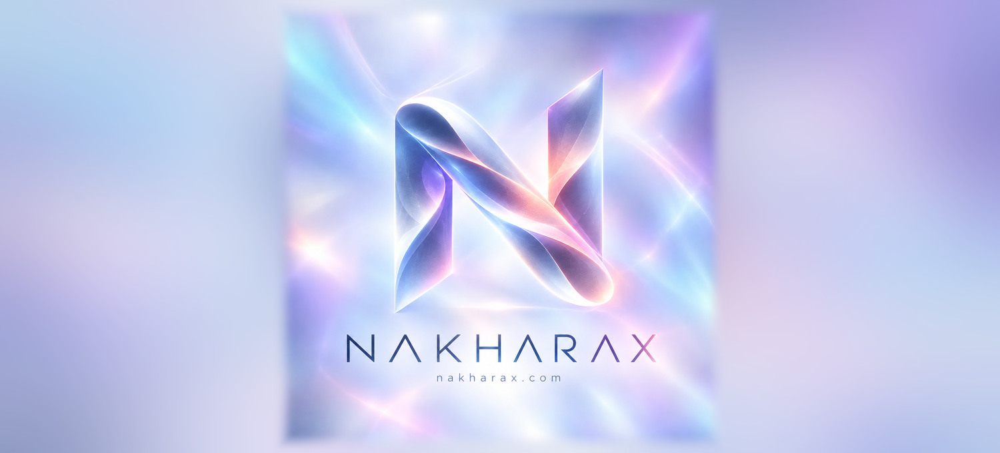
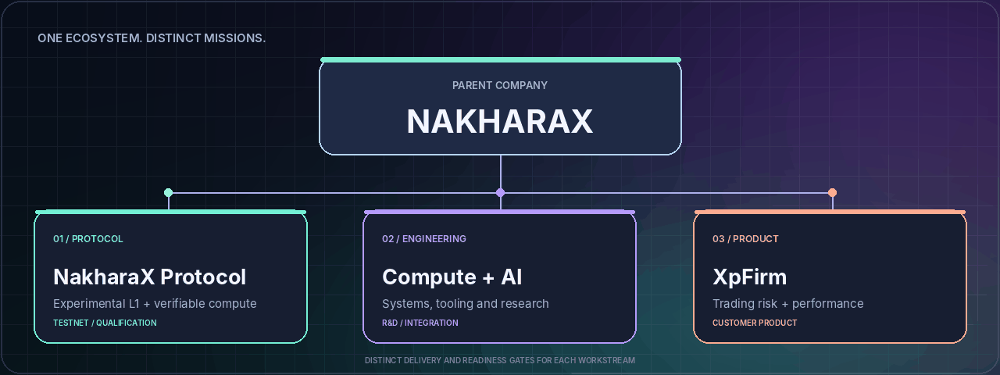
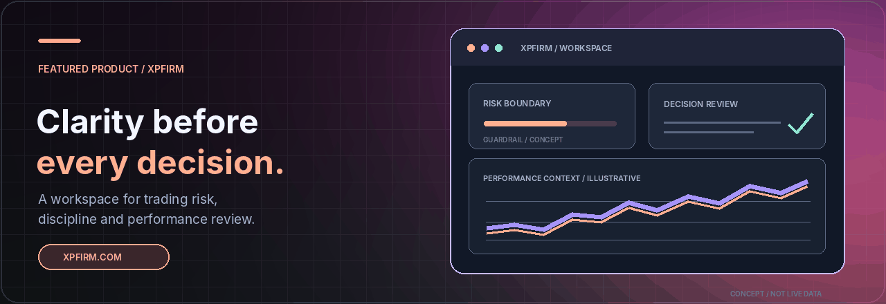

<div align="center">

<a href="https://nakharax.com">
  
</a>

<br />

**An independent ecosystem exploring verifiable infrastructure, intelligent systems, and products built for real-world decisions.**

NakharaX is the **parent company**. XpFirm is **one of its products**.

<br />

[](https://nakharax.com)
[](https://xpfirm.com)
[](#03--proof-over-promises)

<sub>PROTOCOL RESEARCH · COMPUTE + AI ENGINEERING · DIGITAL PRODUCTS</sub>

</div>

---

## 01 · Building across three frontiers

We believe infrastructure and products should be connected by **engineering discipline**, not by inflated claims. Each initiative has its own scope, milestones, and readiness gates.



<table>
<tr>
<td width="33%" valign="top">
<h3>◈ Protocol</h3>
<p><strong>Verifiable foundations.</strong> An experimental Layer-1 and decentralized compute workstream, with explicit testnet and Mainnet qualification gates.</p>
<p><a href="https://nakharax.com">Explore the protocol</a></p>
</td>
<td width="34%" valign="top">
<h3>◇ Compute + AI</h3>
<p><strong>Intelligence with structure.</strong> Engineering and research into workload orchestration, worker systems, tooling, and auditable execution.</p>
<p><em>Research and integration workstream</em></p>
</td>
<td width="33%" valign="top">
<h3>◆ Digital products</h3>
<p><strong>Useful by design.</strong> Practical software built around user problems, decisions, transparency, and a clear experience.</p>
<p><a href="https://xpfirm.com">Meet XpFirm</a></p>
</td>
</tr>
</table>

## 02 · Featured product — XpFirm

<a href="https://xpfirm.com">
  
</a>

**A risk and behavior workspace for self-directed traders — Free Core Forever is the chosen product direction.** XpFirm is a NakharaX product focused on risk visibility, user-defined rules, and evidence-based review. Free Core is being introduced through a controlled, feature-flagged pilot; it must not be mistaken for universal live access.

<table>
<tr>
<td width="33%" valign="top"><strong>01 / Risk context</strong><p>Keep account limits, exposure, and guardrails visible as part of the workflow.</p></td>
<td width="34%" valign="top"><strong>02 / Decision clarity</strong><p>Make trading activity easier to inspect and reason about.</p></td>
<td width="33%" valign="top"><strong>03 / Continuous review</strong><p>Build better feedback loops from evidence, not guesses.</p></td>
</tr>
</table>

<sub>Product illustration above is conceptual. It is not a screenshot, a live trading account, a verified performance record, or a guarantee that each depicted interface element is currently shipped.</sub>

[**Explore XpFirm →**](https://xpfirm.com) · [Free Core implementation and rollout](https://github.com/nakharax/nakharax-xpfirm/blob/main/docs/README_FREE_CORE_ALIGNMENT_2026-10-26.md) *(implementation repository may require access)*

## 03 · Proof over promises

Technical ambition matters. **Operational evidence matters more.** NakharaX Protocol remains an experimental initiative: a healthy landing page, a past benchmark, or a testnet demo should never be mistaken for production proof.

| Network / capability | Status and evidence boundary |
| :--- | :--- |
| **Public testnet** | Chain ID `86137` (`0x15079`). Experimental; do not infer current block progression from network reachability alone. |
| **Public RPC** | [`rpc.nakharax.com`](https://rpc.nakharax.com). Availability and freshness should be checked at time of use. |
| **Mainnet** | Chain ID `86150` is reserved. **Not launched**; release gates remain open. |
| **Compute / marketplace** | Distinguish local/mock tests, specific public testnet deployments, and planned versions before making availability claims. |
| **Performance / finality** | Only publish independently verifiable, dated measurements and clearly qualified finality evidence. |

> [!IMPORTANT]
> **Latest operational evidence reviewed: 2 October 2026.** A read-only testnet liveness check passed 11/12 checks, but **failed block freshness**. That dated result does not establish current liveness. Historic passing samples do not supersede it, and Mainnet remains gated. Check new evidence before drawing an operational conclusion.

**Reference:** [Current Network Status](https://github.com/nakharax/nakharax/blob/master/docs/CURRENT_NETWORK_STATUS.md) and [Architecture Freeze](https://github.com/nakharax/nakharax/blob/master/services/core/ops/deploy/ARCHITECTURE_FREEZE_2026-09.md) (implementation-source access may be required). Public portal: [nakharax.com](https://nakharax.com).

## 04 · The engineering behind the mission

<table>
<tr><td width="50%" valign="top">

**Protocol systems**

- Rust node, network and consensus work
- Testnet operations and recovery tooling
- API and JSON-RPC integrations
- Evidence-based Mainnet qualification

</td><td width="50%" valign="top">

**Developer and product systems**

- Python worker and compute components
- Solidity marketplace contract development
- TypeScript client and SDK tooling
- Next.js interfaces and operator dashboards

</td></tr>
</table>

**Brand assets:** [View the supplied Aurora logo](./assets/nakharax-aurora-logo.jpg) · [View the GitHub hero banner](./assets/nakharax-aurora-hero.jpg). The README hero uses the supplied logo artwork, not a newly invented symbol.

The infrastructure initiative was formerly called **Axionax Protocol**. The separately maintained [NakharaX Protocol repository](https://github.com/nakharax/nakharax) is private; the former public [Axionax Core](https://github.com/nakharax/axionax-core-universe) and [Axionax Web](https://github.com/nakharax/axionax-web-universe) repositories are archived historical snapshots, **not current deployment sources**. Historic names and development artifacts may still appear in code and migration notes; they do not supersede current naming or operating evidence.

<details>
<summary><strong>Repository layout and contribution notes</strong></summary>

This repository (`nakharax/nakharax-readme`) is **the public-facing landing page, not the runtime monorepo**. Its structure is intentionally lightweight:

```text
nakharax-readme/
├── README.md
├── assets/
│   ├── nakharax-aurora-hero.jpg
│   ├── nakharax-aurora-logo.jpg
│   ├── ecosystem-map.png
│   ├── xpfirm-spotlight.png
│   ├── nakharax_brand.svg
│   └── nakharax_token.svg
├── .github/
├── AGENTS.md
├── LICENSE
├── .gitmodules
└── nakharax/              # Existing pinned source submodule
```

**Clone the landing repo:**

```bash
git clone https://github.com/nakharax/nakharax-readme.git
cd nakharax-readme
```

The pinned `nakharax/` submodule still references an older `axionaxprotocol/nakharax` location in `.gitmodules`. It is deliberately **not** modified here; source access may be restricted. Its target, access policy, and pinned revision should be reviewed in a separate change.

For corrections to this landing page, open an [issue](https://github.com/nakharax/nakharax-readme/issues) or a [pull request](https://github.com/nakharax/nakharax-readme/pulls). Protocol implementation work belongs in the maintained implementation repository.

</details>

## 05 · Our operating principles

<table>
<tr>
<td width="33%" valign="top"><strong>Evidence first</strong><p>Measured observations and reproducible checks outrank screenshots and marketing status.</p></td>
<td width="34%" valign="top"><strong>Clear boundaries</strong><p>Research, testnet, demos, customer products, and production releases are not interchangeable.</p></td>
<td width="33%" valign="top"><strong>Build to learn</strong><p>Ship improvements around user needs, measurable quality, and real feedback.</p></td>
</tr>
</table>

---

<div align="center">

### Explore the ecosystem

[**NakharaX**](https://nakharax.com) &nbsp; · &nbsp; [**XpFirm**](https://xpfirm.com) &nbsp; · &nbsp; [**GitHub**](https://github.com/nakharax/nakharax-readme) &nbsp; · &nbsp; [**Contribute**](https://github.com/nakharax/nakharax-readme/pulls)

<sub>© NakharaX · Crafted with intent · Updated 25 October 2026</sub>

<sub>This landing repository is distributed under the <a href="LICENSE">MIT license</a>. Separately maintained implementation repositories may have different licensing terms.</sub>

</div>
